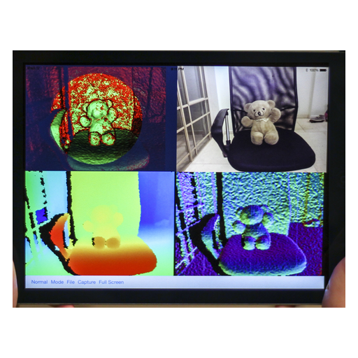

# Mobile Point Fusion

 [Updated and ported for modern hardware](updated/README.md#updated-and-ported-for-modern-hardware)

*Historical project reference follows. Current builds and results are in the updated section above.*

Mobile Point Fusion investigated point-based 3D reconstruction on iOS. This repository preserves a January 2015 PointsFusion v2.3 snapshot with Objective-C application code, OpenGL ES correspondence shaders and CPU-side fusion. It predates a reported October 2015 final release, which has not been recovered or verified.

Original project credits: D. Ben-Hoda, G. Kamar, Aaron Wetzler, Y. Honen, Ron Kimmel.

*The figure is an unchanged photograph from the archived project page, not evidence of a newly running application.*

## Implementation and source

The [original snapshot](source/original/) includes the Xcode project, application, storyboards and GLSL shaders. `ViewController.m` loads vertex/normal data from a bundled OBJ model, builds GPU textures and reads correspondence results back for point fusion/removal on the CPU. `indexMap` stores point identifiers, positions and normals; `Fusion` selects candidate model points using the projected input and normal agreement. The preserved entrypoint uses an OBJ test model; it is not evidence of a recovered live depth-camera pipeline.

The allowlist contains 28 source/project files. Twenty-seven retain their recovered bytes; one commented-out shader line has a workstation name replaced, with executable code unchanged. [Provenance](source/PROVENANCE.json) records paths and hashes. Sample OBJ models, the launch bitmap, user state and old ZIPs were excluded.

## Inspect the project

Open `source/original/PointsFusion/PointsFusion.xcodeproj` in Xcode. It targets iOS 7.1 and uses UIKit, GLKit and OpenGL ES 3. The project still refers to `zero.obj`, `monkey.obj`, `capsule.obj` and `Porsche_911_GT2.obj`, which were intentionally omitted because their redistribution provenance was not established.

Restoration requires appropriately licensed replacement resources, updated Xcode/platform settings and compatible Apple hardware. There is no verified modern installation command or ready-to-run release. The recovered test target is a placeholder, not an algorithm test suite.

## Validation and limitations

The recorded November 2026 Xcode 16.1 check could list the project. A stock simulator build found no compatible destination; an unsigned arm64 target build reached resource processing and failed on the missing OBJ resources. Those checks used a private native-filesystem copy and did not change the original project settings.

No app was run, and no shader correctness, fusion accuracy, camera capture or performance benchmark was measured. The archive has no updated port or notebook. A future offline fusion exercise would be new work and would need its own validation.

## Original code and attribution

Student and third-party notices remain in the recovered files. No blanket license is assigned. Authors can open an issue to contribute changes, correct attribution or request removal.

## Links

- [Project entry on Aaron Wetzler's website](https://twerdster.github.io/#mobile-point-fusion)
- [Project page](https://gip.cs.technion.ac.il/last-projects-2016-2.html)
