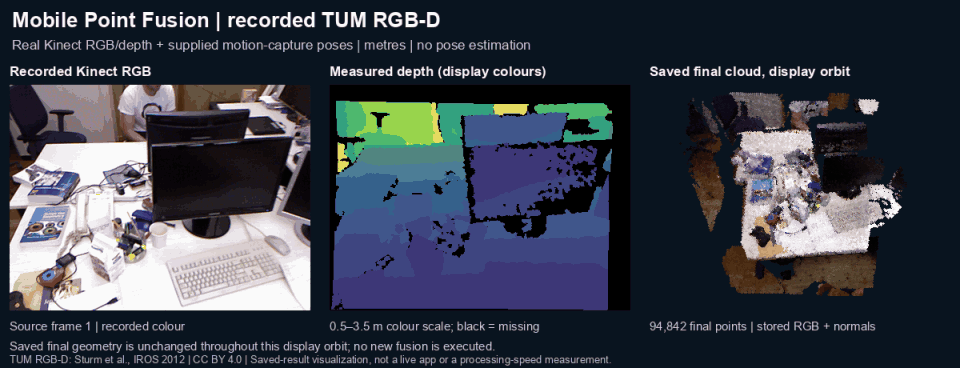
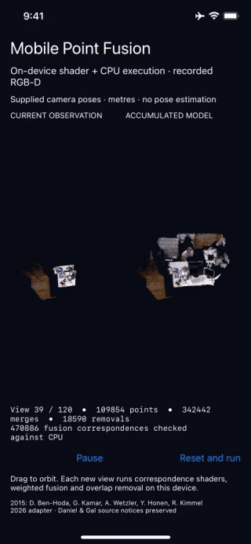

# Point-fusion adapter

## Updated and ported for modern hardware

This 2026 port reimplements the historical CPU fusion loop in C++ and retains the original index-map shaders, with targeted changes to matching, removal and buffer safety. New iOS, Android, macOS and Linux frontends run generated input or recorded Kinect depth; real-data replay uses supplied camera poses, without live capture or motion estimation.

| Saved real-data result | Actual iPhone app |
| --- | --- |
|  |  |

*Real TUM Kinect RGB/depth, using supplied motion-capture poses. Left: saved 94,842-point Linux result, with display-only orbit. Right: an excerpt of actual iPhone execution. USB capture timing and clip playback do not measure processing speed.*

[Preview MP4](assets/real-rgbd-preview.mp4) · [Still image](assets/real-rgbd-preview.png) · [Real-data guide and measurements](REAL_RGBD.md)

Real-data app recordings: [iOS](assets/ios-real-rgbd.mp4) · [Android](assets/android-real-rgbd.mp4) · [Mac](assets/macos-real-rgbd.mp4) · [Linux](assets/linux-real-rgbd.mp4).

This 2026 adapter unprojects recorded depth, estimates local normals and combines observations through the preserved indexMap shaders, adapted Fusion/PointRemoval shaders and a C++ translation of the historical weighted merge. Native frontends execute the shared shader/CPU core. The original source and root project reference retain their published bytes; see [provenance](../source/PROVENANCE.json).

## Build and use

Linux requirements: CMake 3.20+, C++17, pkg-config, EGL/GLES development libraries and Mesa with ES3 integer and RGBA32F render targets. Tested: Ubuntu 22.04, GCC 11.4 and Mesa 23.2.1 llvmpipe.

From the repository root:

```sh
cmake -S updated -B build/offline -DCMAKE_BUILD_TYPE=RelWithDebInfo
cmake --build build/offline --parallel 2
export LIBGL_ALWAYS_SOFTWARE=1 EGL_PLATFORM=surfaceless LP_NUM_THREADS=2
export __EGL_VENDOR_LIBRARY_FILENAMES=/usr/share/glvnd/egl_vendor.d/50_mesa.json
ctest --test-dir build/offline --output-on-failure
build/offline/points_fusion \
  --recording updated/data/tum-fr1-xyz-120.pfrgbd \
  --export-inputs --output fusion-output-rgbd
```

The included pack selects 120 frames across 26.594239 seconds of TUM Freiburg 1 xyz, the same archive used by OpenFusion. Every fourth pixel is retained, giving 160 × 120 input. Depth is in metres. Supplied camera poses align the frames; this program does not estimate motion. Outputs include per-frame input PLYs, `fused.ply`, `frames.jsonl` and `native-state.json`. These are point clouds, not meshes.

The vendor path selects Mesa EGL; software rendering is selected separately. For another vendor path, change the exported `__EGL_VENDOR_LIBRARY_FILENAMES` for direct runs and configure CTest with `-DMESA_EGL_VENDOR_FILE=/path/to/50_mesa.json`. Check the reported renderer. See [native builds](NATIVE.md), [data preparation and format](RGBD_FORMAT.md) and [implementation/build details](BUILD.md).

## What was checked

Linux processed 1,460,277 accepted real-depth observations, making 1,133,826 merges and retaining 94,842 points. A separate comparison with 12 excluded nearby sensor views found 87.13% point-centre coverage for the fused cloud, versus 99.66% for all raw observations. Within 50 mm of measured depth, the respective fractions of all valid pixels were 76.14% and 80.70%. This does not establish denoising or overall accuracy improvement; [the measurements](REAL_RGBD.md#measured-checks-and-limits) describe projection effects and different residual denominators.

All four native apps completed the 120-frame replay: physical iPhone 12 and Pixel 2, Mac M3 Max and Linux software Mesa. Mac and iOS each needed one bounded GPU-query recheck followed by an exact CPU winner; all other selections matched directly. Counts differ slightly between platforms and remain in the [runtime record](validation/real-rgbd/runtime-validation.json).

Four CTests pass 84 constructed CPU/GPU assertions in regular, sanitizer and integer-framebuffer builds. Twenty Python cases cover conversion and saved-cloud evaluation. [Validation records](validation/real-rgbd/) distinguish these checks from real-scene measurements. Sanitizers also completed all 120 Linux frames; Mesa/shaders and leaks were not checked.

## Generated fixture and limits

The earlier 48-view generated ellipsoid remains available:

```sh
build/offline/points_fusion --demo --frames 48 --output fusion-output
```

Its [saved-cloud preview](assets/demo.gif), actual native recordings ([iOS](assets/ios-native.mp4), [Android](assets/android-native.mp4), [Mac](assets/macos-native.mp4), [Linux](assets/linux-native.mp4)) and [validation](NATIVE_VALIDATION.json) use generated observations and known poses. They are separate from the real-data replay. The generated test increases finite-reference RMSE; [recorded results](VALIDATION.json) do not demonstrate denoising either.

The adapter repairs unsafe reads, removal payloads and slot reuse. Camera-space comparisons and bounded confidence/ID-ordered overlap removal are maintenance changes, described in [BUILD.md](BUILD.md#implementation-and-retained-behavior). Real input gives the retained 0.055 match gate and 0.012 point radius metre units (55 mm and 12 mm). No live depth capture, pose tracking or performance benchmark is validated. Optional OBJ input requires one ordered normal per vertex.

Original credits: D. Ben-Hoda, G. Kamar, Aaron Wetzler, Y. Honen, Ron Kimmel. Daniel & Gal notices remain; no blanket source license is inferred. TUM data is separately credited under [CC BY 4.0](data/NOTICE.txt).
