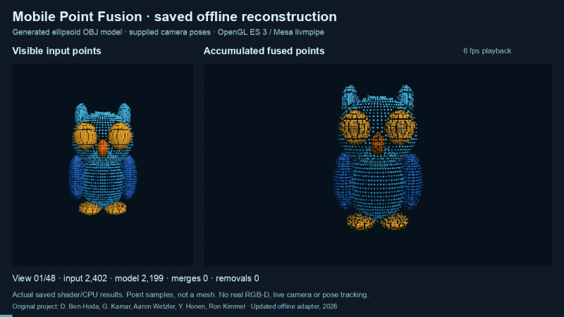
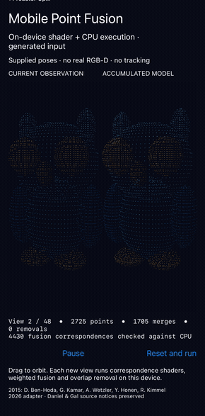

# Point-fusion adapter

| Saved-cloud preview | Native iPhone app |
| --- | --- |
|  |  |

*Left: offline reprojection of saved Linux clouds. Right: a physical iPhone 12 computing and displaying fusion. Both use generated input and supplied poses; playback does not measure processing speed.*

[Offline MP4](assets/demo.mp4) · [PNG](assets/demo.png) · [Final cloud](examples/fused.ply)

Native app movies: [iOS](assets/ios-native.mp4) · [Android](assets/android-native.mp4) · [macOS](assets/macos-native.mp4) · [Linux/Xvfb](assets/linux-native.mp4)

This 2026 adapter runs the preserved indexMap shaders ([compilation adaptations](NATIVE.md)), adapted Fusion/PointRemoval shaders and a C++ translation of ViewController.m's weighted averaging. Native frontends share the command-line shader/CPU core. Historical files retain published bytes, including one recorded comment privacy edit; see [provenance](../source/PROVENANCE.json).

## Build and use

Linux command-line requirements are CMake 3.20+, C++17, pkg-config, EGL/GLES development libraries and Mesa with ES3 integer and RGBA32F render targets (GL_EXT_color_buffer_float). Tested: Ubuntu 22.04, GCC 11.4 and Mesa 23.2.1 llvmpipe.

From the repository root:

```sh
cmake -S updated -B build/offline -DCMAKE_BUILD_TYPE=RelWithDebInfo
cmake --build build/offline --parallel 2
export LIBGL_ALWAYS_SOFTWARE=1 EGL_PLATFORM=surfaceless LP_NUM_THREADS=2
export __EGL_VENDOR_LIBRARY_FILENAMES=/usr/share/glvnd/egl_vendor.d/50_mesa.json
ctest --test-dir build/offline --output-on-failure
build/offline/points_fusion --demo --frames 48 --output fusion-output
```

Select Mesa EGL with the vendor file and software rendering with LIBGL_ALWAYS_SOFTWARE=1. Override MESA_EGL_VENDOR_FILE for other CTest vendor paths; check the renderer.

The demo writes/reloads generated-input.obj, selects visible samples at 192×144 from 48 known views and adds a bounded ±0.003 model-unit offset along each surface normal (deterministic sinusoid). Coordinates are arbitrary model units, not millimetres. Outputs include per-view input/model PLY, reference.ply, fused.ply and metrics.json. These are point samples, not a mesh. Optional OBJ import requires one ordered normal per vertex; it is not a general face-index importer.

[Native Mac, iOS, Android and Linux frontends](NATIVE.md) provide actual shader/CPU execution, Pause/Reset and orbit controls; platform verification is recorded separately. Python/NumPy/Pillow/FFmpeg support [saved-cloud analysis and rendering](BUILD.md). The offline GIF/MP4 reproject saved clouds; playback does not measure processing speed.

## Changes and checks

The adapter repairs unsafe new-point reads and removal payloads, manages reusable slots, separates sampling/render targets, queries uniforms per program and supplies initialized buffers/depth attachments. Camera-space comparisons, a 0.055-unit match gate and confidence/ID-ordered overlap removal are explicitly changed behavior. [Implementation details](BUILD.md#implementation-and-retained-behavior) distinguish these adaptations from historical code.

Two CTest entries pass 25 targeted CPU/GLES assertions covering compilation/linking of three shader pairs, transforms, correspondence choices and bounded removal IDs against CPU references. Coverage is limited to these fixtures.

CPU boundary tests cover age expiry, which never triggers in this sequence; all demo removals are overlap removals.

The 48-view run generated 104,043 visible observations; projection collisions left 95,791 rasterized records, all merged or inserted. It recorded 81,563 merges and 14,228 insertions, including 4,352 reused slots. After 4,996 overlap removals, 9,232 points remained.

Within 0.02 model units of the finite reference, coverage is 31.34% for the first view, 92.09% for all raw observations and 88.60% for the fused cloud. The gain over the first view reflects added views; fused coverage is about 3.5 percentage points below the raw union. Fusion increases nearest-reference RMSE from 0.00212 for all raw observations to 0.00392; fused p95/max errors are 0.00769/0.01955, exceeding the 0.003 input-noise bound. This is an accuracy limitation, not demonstrated denoising. The sampled reference includes hidden primitive intersections.

ASan/UBSan completed the corrected tests and 48 views with no reports and halt-on-error enabled. Mesa libraries/shader code were not instrumented; leaks were not checked. [Validation and logs](VALIDATION.json) also retain the two failing original-expression diagnostics and their scope.

## Limits and attribution

No real RGB-D, live capture, pose tracking or performance benchmark is validated. Native fixtures have run on Mac/Linux and physical Android/iOS; [platform records](NATIVE_VALIDATION.json) retain their actual counts. The historical generated-resource Xcode build was never launched; it remains separate from the new UIKit frontend. See [build history](BUILD.md#original-xcode-check).

Original credits: D. Ben-Hoda, G. Kamar, Aaron Wetzler, Y. Honen, Ron Kimmel; Daniel & Gal notices remain. Generated fixtures and this adapter are new work. No blanket source license is inferred.
